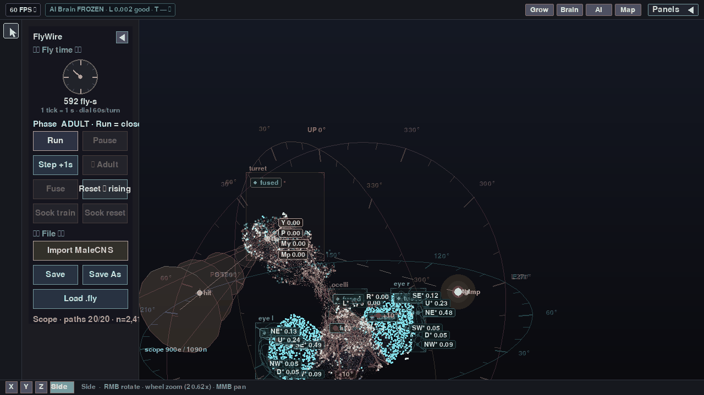
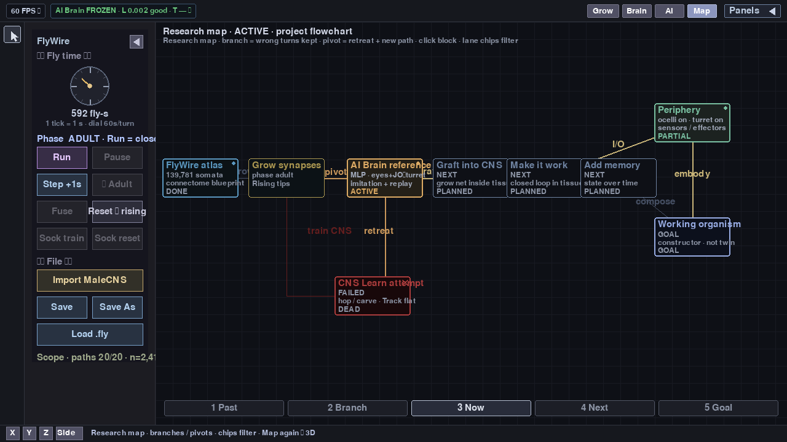
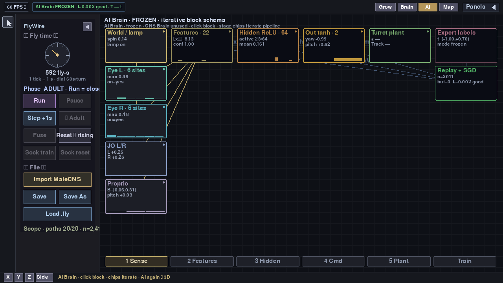
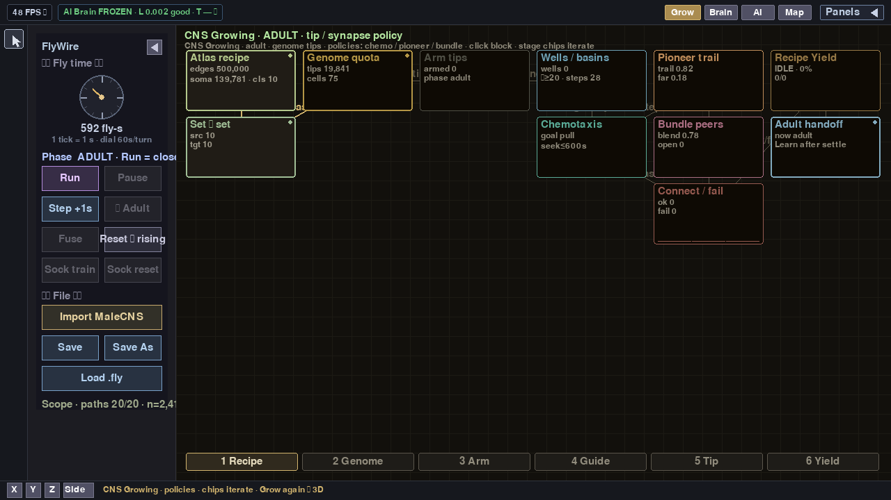

# Vibe Fly Brain

**Vibecode a nervous system from a fly connectome.**

Constructor for bio-like neural nets: take one successful CNS blueprint (FlyWire / MaleCNS), grow and mutate a recipe, drive it with honest meters — not a digital twin of the fly.

Repo: [`VibeFlyBrain`](.) · shell: `genome_shell.py`

## Screenshots

<p align="center">
  
</p>

| Shell (3D tissue) | Research map |
|:---:|:---:|
|  |  |
| **AI Brain** (reference drive) | **CNS Growing** (tip / synapse policy) |
|  |  |

## What this is / isn’t

| Is | Isn’t |
|----|--------|
| Editable constructor recipe from one connectome | Product story: “digital twin of the fly” |
| Grow → mutate → still-working net | End-to-end training of ~50M synapses |
| Honest UI: scope / hop / carve / devices | MLP-layer diagrams as the main visual language |
| Learn *stimulation* (AI Brain) with frozen topology | Paper-clone Shiu LIF / classic MB demo as the goal |

Success test: *change the recipe → get a different still-working nervous system.*

## Install & run

```bash
git clone https://github.com/<you>/VibeFlyBrain.git
cd VibeFlyBrain

python3 -m venv venv
source venv/bin/activate          # Windows: venv\Scripts\activate
pip install -r requirements.txt

bash scripts/download_data.sh     # MaleCNS soma + process clouds → data/processed/
python genome_shell.py
```

**In the shell:** `Import MaleCNS` (or Load a `.fly`) → Grow / Brain / AI / Map from the top bar.

Optional denser processes (~8GB parquet path):

```bash
python scripts/build_malecns_clouds.py --from-synapses
```

Refresh README shots:

```bash
python scripts/render_readme_shots.py --gif
```

## Data

Raw connectome material stays **out of git** (`data/raw/`, `data/processed/`, `data/flies/` — see `.gitignore`). Re-fetch locally:

| Artifact | Source | Role |
|----------|--------|------|
| `data/processed/malecns_somas.npz` | MaleCNS annotations | ~142k somata (brain + VNC) |
| `data/processed/malecns_processes.npz` | MaleCNS SWC sample | process cloud |
| `data/raw/malecns/` | lee-lab / FlyEM | meta + SWC cache |

## License

Code in this repository is **MIT** — see [`LICENSE`](LICENSE).

Connectome data (FlyWire / MaleCNS) stays under **upstream** terms; this license does not relicense it. Cite below; do not treat raw/derived clouds as MIT just because the shell is.

Future product value may live outside this public showcase — MIT here is the vitrine, not a promise that every later line stays open.

## Cite

- Dorkenwald et al., *Nature* 2024 — FlyWire (FAFB) connectome  
- MaleCNS / BANC — Janelia / lee-lab whole CNS  

Respect upstream data licenses when redistributing derived clouds.
